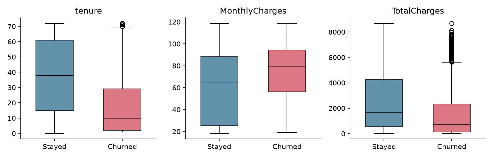
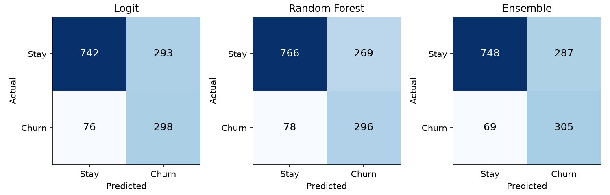

# Telco Customer Churn Prediction

Predicting which telecom customers will leave (churn), using Logistic Regression, a Random Forest and a soft-voting ensemble.
Individual project for *Introduction to Data Science* (CERGE-EI Foundation Distance Learning Program, Fall 2026).

> **Note:** this project was built with the help of an AI assistant. I reviewed the code and results and can explain each step.

## Data

[Telco Customer Churn](https://www.kaggle.com/datasets/blastchar/telco-customer-churn) (`WA_Fn-UseC_-Telco-Customer-Churn.csv`): 7,043 customers, 21 fields, 26.5% churn.
The CSV is not included in this repository. Download it and place it next to the script.

## What the script does

| Step | Description |
|---|---|
| 1. Raw data | Field overview, descriptive statistics, IQR outlier check, boxplots |
| 2. Cleaning | Drop ID, fix 11 blank `TotalCharges` (new customers, tenure 0), merge "No internet/phone service" into "No", one-hot encoding |
| 3. New variables | `NumAddOns`, `TenureGroup`, `AvgMonthlySpend`, `M2M_ECheck`, `LogTotalCharges` |
| 4. Split | Random 80/20 split, stratified on churn (the data has no dates, so no time-based split) |
| 5. Models | Logistic Regression, Random Forest (400 trees, depth 8), soft-voting ensemble; `class_weight="balanced"` |
| 6. Evaluation | Classification reports and confusion matrices on the test sample |
| 7. Bias checks | ROC-AUC by gender and senior status, train vs test AUC |

## Results (test sample, n = 1,409)

| Model | Churn precision | Churn recall | Churn F1 | Accuracy | ROC-AUC |
|---|---|---|---|---|---|
| Logistic Regression | 0.50 | 0.80 | 0.62 | 0.738 | 0.847 |
| Random Forest | 0.52 | 0.79 | 0.63 | 0.754 | 0.846 |
| **Ensemble** | 0.52 | **0.82** | 0.63 | 0.747 | **0.849** |

The ensemble catches 305 of 374 churners (69 missed, 287 false alarms).
Always predicting "stay" gives 73.5% accuracy, so accuracy alone is misleading here.




Findings: churn falls from 47.4% in a customer's first year to 9.5% after four years.
ROC-AUC is lower for senior customers (0.79) than for non-seniors (0.85).

## Limitations

- Single snapshot without dates: drift over time cannot be tested.
- Public sample dataset: results may not transfer to other markets.
- Coefficients and importances show associations, not causes.
- Results depend on the 0.5 cut-off and the class weights.

## Run it

```bash
pip install -r requirements.txt
python telco_churn_project.py
```

Figures and `metrics.json` are written to `outputs/`. Results are reproducible (`random_state=42`).
Tested with Python 3.14, pandas 3.0, scikit-learn 1.9.
